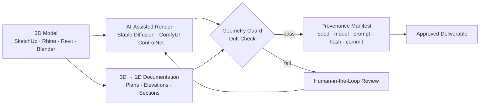

<div align="center">

# 🏛️ Naeem Synon

### AI Automation Engineer · Architectural Visualization Specialist

*AI-assisted renders and drawings you can reproduce, verify, and trust.*


`SketchUp` · `AutoCAD` · `Rhino` · `Revit` · `Archicad` · `V-Ray` · `Corona` · `Enscape` · `Lumion` · `Twinmotion`

</div>

---

## 👋 About

I build automation that makes **architectural visualization faster without letting AI quietly change the design**.

- 🎨 **5 years** of architectural visualization: photorealistic stills, animations, and real-time walkthroughs
- 🤖 **3 years** building AI-assisted and automated production pipelines
- 🎓 BSc (Hons) Computer Science, Open University of Sri Lanka (2026), thesis: *Verifiable Generative Visualization: A Software-Engineering Framework for AI-Assisted Architectural Visualization*
- 🖥️ Diploma in IT (Computer-Aided Design Software), Pearson UK
- 🌍 Remote since 2024, working with US teams across time zones

---

## 🧭 The Core Idea



---

## 🚀 Featured Projects

### 1️⃣ Provenance-Stamped Render Pipeline
> *Can an AI-assisted render be reproduced exactly?*

A **Blender Python** pipeline that renders a scene and writes a **manifest** beside every image.

| Recorded in the manifest | Why it matters |
|---|---|
| Model and version | Know exactly what produced the image |
| Seed and prompt | Deterministic regeneration |
| Render settings | Consistent quality across views |
| Hash of the config | Detect silent changes |
| Git commit of the source scene | Trace the image back to the approved model |

A second script reads a manifest and **regenerates the identical image**.
**Measured:** reproducibility rate and time to rebuild an old image from its manifest alone.

`Python` `Blender` `Git` `Reproducibility` `Provenance` `Render Pipeline`

---

### 2️⃣ Geometry Guard: Automated AI-Drift Checker
> *Catch the moment an AI image or generated scene quietly changes the design.*

Takes one source model (e.g., a small house exported to **OpenUSD**), generates variants two ways:

- 🖼️ **Diffusion** with depth and edge conditioning (ControlNet)
- 📝 **LLM-written scene scripts**

then verifies each variant against the source and flags:

- ✅ Changed element counts (windows, doors)
- ✅ Dimensional deviations
- ✅ Implausible material values
- ✅ Camera and scale errors

**Measured:** errors caught by the tool versus errors caught by people.

`OpenUSD` `ControlNet` `Stable Diffusion` `LLM` `Verification` `QA Automation` `Geometry Validation`

---

## 💼 Production Automation Experience

Real-world automation work behind these ideas (see CV for detail):

| Area | Outcome |
|---|---|
| **Support triage** (n8n + Claude agent) | ~1,500 tickets/month routed; first response **4 hrs → 12 min**; ~120 hrs/month saved |
| **Invoice processing** (Claude extraction + Zapier) | 100+ invoices/month at **96% accuracy**; handling **15 min → <1 min** |
| **RAG knowledge assistant** | Over 2,000+ docs, ~90% answer accuracy, **35% less handling time**, SOPs updated |
| **Reliability and guardrails** | Retries, alerting, output validation, approval gates, HITL; **99%+ success** over 1,000+ monthly runs; ~80% fewer unsupported responses |
| **Cost optimization** | Prompt, model, and caching tuning, **~40% lower LLM spend** |
| **Vendor onboarding** (Make) | **10 days → 3 days** across ~250 vendors/year |
| **Incident workflows** | Time-to-engage **30 → 5 min**; alerts to 500+ recipients in <10 sec |

---

## 🛠️ Tech Stack

| Domain | Tools |
|---|---|
| **Visualization** | Blender · Rhino · SketchUp · Revit · Archicad · V-Ray · Corona · Unreal Engine 5 · Twinmotion · Enscape · Lumion |
| **Generative AI** | Stable Diffusion · ComfyUI · ControlNet · LoRA training · Midjourney · Prompt engineering · Claude · OpenAI APIs · RAG · MCP |
| **Automation & Pipelines** | Python · Grasshopper · Dynamo · MaxScript · n8n · Make · Zapier · REST APIs · Git · IFC · BIM coordination · Render farm management |
| **Post-production** | Photoshop · Lightroom · After Effects · DaVinci Resolve |
| **Enterprise** | SAP · Salesforce · ITIL/ITSM · Agile · CI/CD |
| **Interests** | PBR materials · Photogrammetry · Real-time rendering · Workflow optimization · Scalable pipelines |

---

## 🧪 Principles I Build By

1. **Automate the repetitive 80%.** Put human checkpoints on dimensions and details.
2. **Every output is traceable.** If it can't be reproduced, it can't be trusted.
3. **Measure everything.** Time saved, accuracy, error rate, cost.
4. **Document as you build.** SOPs and clear handoffs so teams actually adopt the tools.
5. **Millimeter-level accuracy is a requirement, not a stretch goal.**

---

## 📁 Repository Structure

```
├── provenance-render-pipeline/    # Blender Python render + manifest + replay scripts
├── geometry-guard/                # AI-drift verification tool (OpenUSD, diffusion, LLM scripts)
├── automation-workflows/          # n8n / Make / Zapier workflow exports (sanitized)
├── sop-templates/                 # SOP and QA checklist templates
└── docs/                          # Thesis summary, diagrams, results
```

---

## 🏆 Certifications

<div align="center">

<table>
  <tr>
    <td align="center" width="25%">
      <br/>
      <b>Zapier</b><br/>
      <sub>MCP & AI LLM Agent</sub><br/><br/>
      
    </td>
    <td align="center" width="25%">
      <br/>
      <b>n8n</b><br/>
      <sub>Workflows & LLM Agents</sub><br/><br/>
      
    </td>
    <td align="center" width="25%">
      <br/>
      <b>ITIL & ITSM</b><br/>
      <sub>via LinkedIn Learning</sub><br/><br/>
      
    </td>
    <td align="center" width="25%">
      <br/>
      <b>Project Management Professional</b><br/>
      <sub>Project Management Institute (PMI)</sub><br/><br/>
      
    </td>
  </tr>
</table>


</div>

---

## 📬 Let's Connect

- 📧 naeemsynon123@gmail.com
- 💼 [LinkedIn](#) · 🐙 [GitHub](#)

<div align="center">

*Architectural Visualization · AI Automation · BIM · Generative AI · Workflow Automation · QA · SOPs*

</div>
